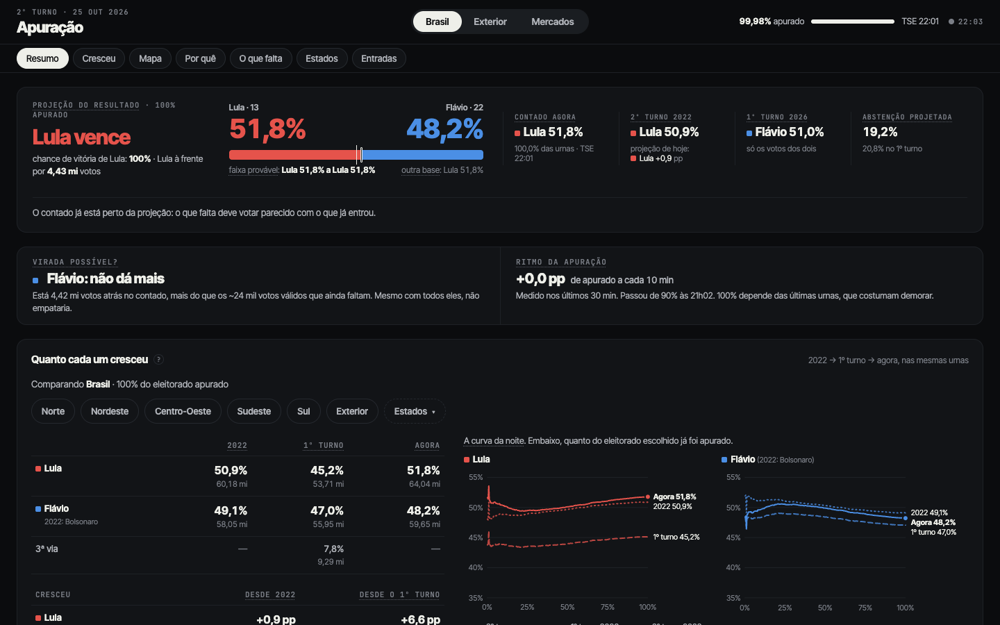
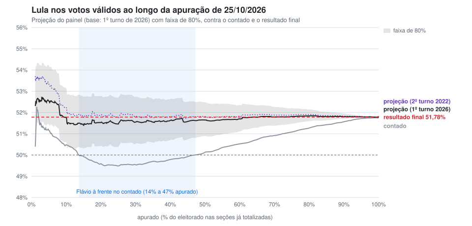
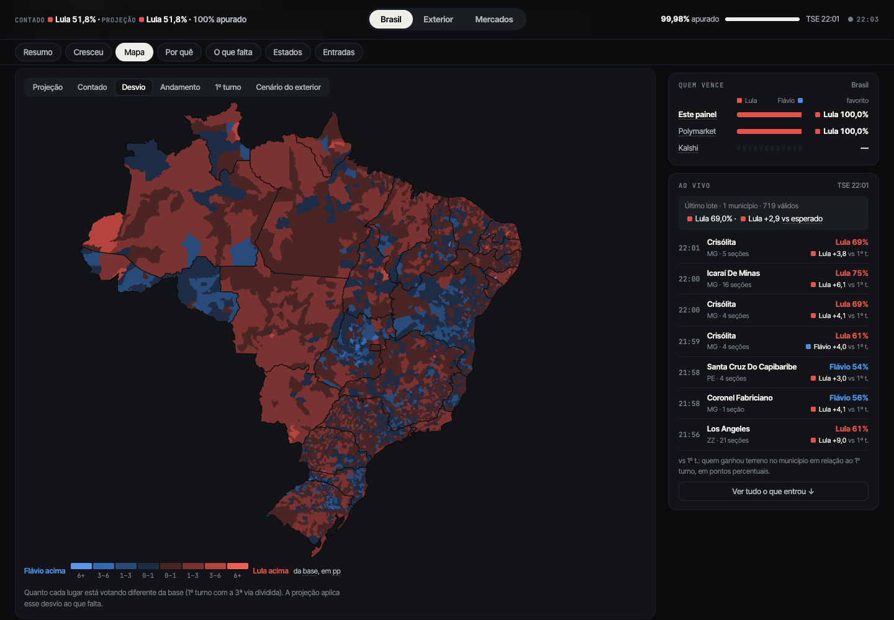
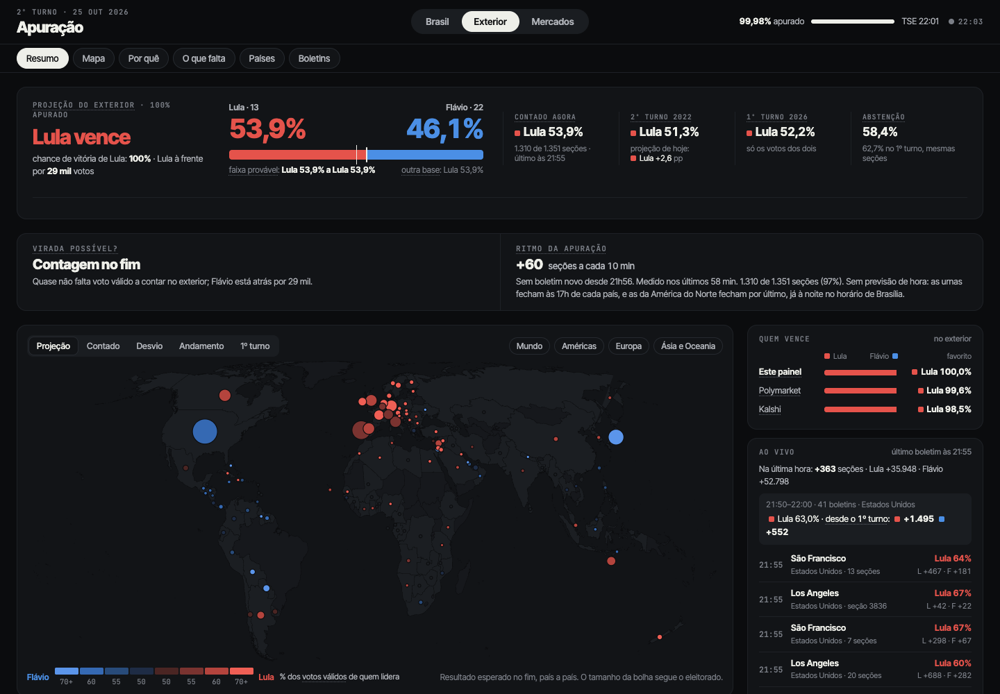
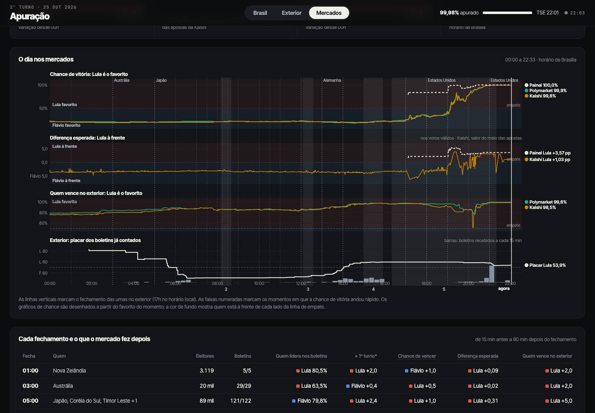
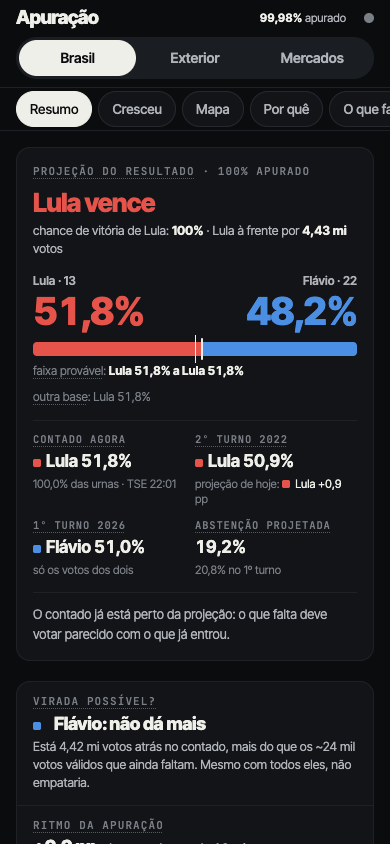
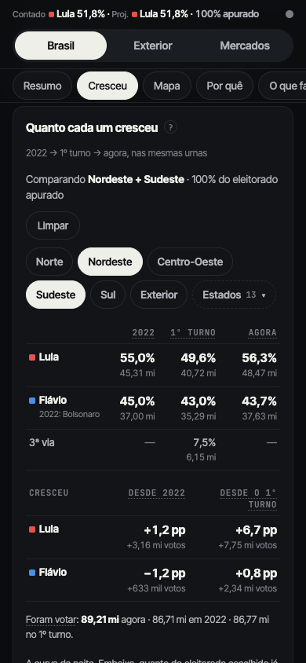
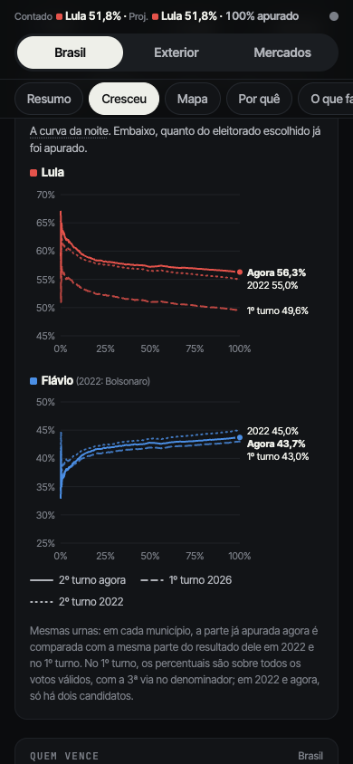
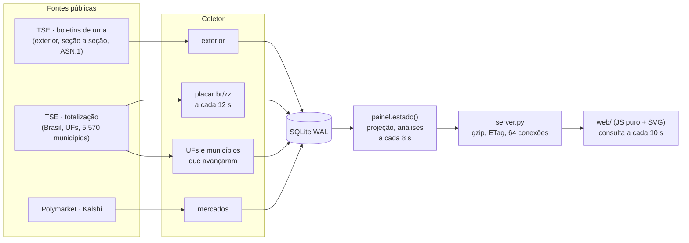
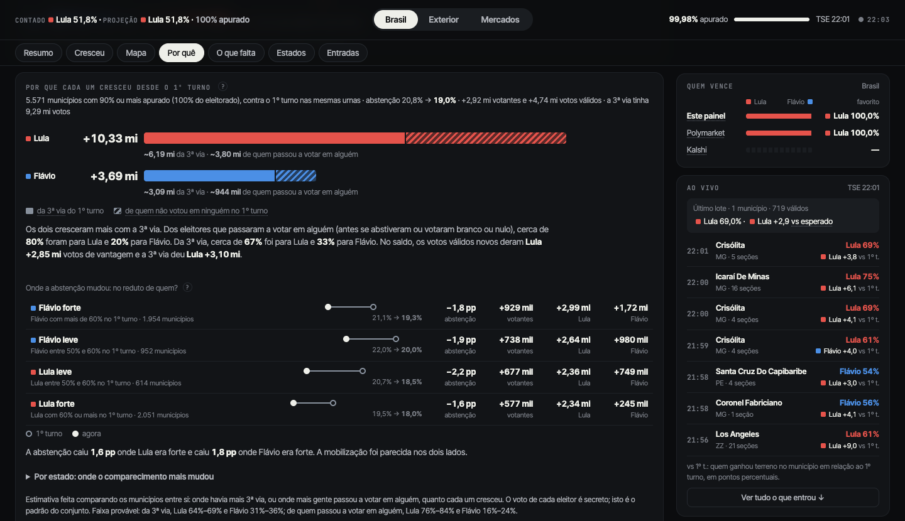

# Apuração 2026

Painel ao vivo do 2º turno presidencial de 25/10/2026 (Lula × Flávio), feito para ser acompanhado pelo celular:
coleta os dados públicos do TSE e de mercados de previsão, projeta o resultado final a partir da apuração parcial
e explica de onde veio o crescimento de cada candidato.

> **In English:** a live dashboard for Brazil's 2026 presidential runoff. It scrapes the electoral court's public
> feeds (per-municipality totals and per-polling-station ballot reports decoded from ASN.1), projects the final
> result with a hierarchical swing model plus a Bayesian bootstrap, and decomposes each candidate's growth with an
> ecological regression. With 10% of the vote counted the projection was within 0.04 pp of the final result, and it
> stayed inside 0.4 pp for the rest of the night, while the raw count showed the eventual loser ahead for a third of it.



## A noite em um gráfico

Lula terminou com **51,78%** dos votos válidos. Entre 14% e 47% apurado, quem liderava o contado era Flávio: as
capitais e o Sul entraram antes do Nordeste. Desde os 10% apurados, a projeção não saiu da faixa de 51,4% a 51,9%.



| Apurado | Hora | Contado | Projeção (base 1º turno 2026) | Faixa de 80% | Erro | Projeção (base 2022) | Erro |
|---:|---:|---:|---:|---:|---:|---:|---:|
| 5% | 19:30 | 50,91% | 52,53% | 51,41–54,19 | +0,75 | 53,32% | +1,53 |
| 10% | 19:40 | 50,37% | 51,74% | 50,58–53,11 | −0,04 | 52,21% | +0,43 |
| 20% | 19:59 | 49,52% | 51,52% | 50,41–52,77 | −0,26 | 51,86% | +0,08 |
| 30% | 20:10 | 49,49% | 51,55% | 50,52–52,74 | −0,23 | 51,82% | +0,03 |
| 50% | 20:29 | 50,15% | 51,65% | 50,89–52,48 | −0,14 | 51,81% | +0,02 |
| 70% | 20:47 | 50,94% | 51,79% | 51,38–52,27 | +0,01 | 51,88% | +0,10 |
| 90% | 21:04 | 51,59% | 51,80% | 51,69–51,95 | +0,02 | 51,82% | +0,04 |

- Erro = projeção − resultado final (51,78%), em pontos percentuais. "Apurado" é a fração do eleitorado nas seções já
  totalizadas.
- A partir de 5% apurado, a faixa de 80% da base de 1º turno conteve o resultado final em **85%** das 1.500
  atualizações. Esse número não vale como teste de calibração: as atualizações são fortemente autocorrelacionadas, e a
  noite inteira é uma única observação.
- Em nenhuma atualização com mais de 5% apurado a chance de vitória de Lula ficou abaixo de 50%. Antes das 17h, os
  mercados de previsão davam a Flávio de 77% a 83% de chance. Polymarket e Kalshi viraram para Lula entre 19h10 e
  19h13, com ~1% apurado. A comparação está na aba Mercados.
- O ensaio com a apuração de 2022 (`scripts/replay_2022.py`) chegou a errar até 0,7 pp no começo da apuração e menos
  de 0,4 pp a partir de 20%.

## O que o painel mostra

| | |
|---|---|
|  |  |
| **Mapa.** Projeção, contado, andamento e **desvio**: quanto cada município vota diferente da base, que é o que a projeção aplica ao que falta. | **Exterior.** Antes das 17h, boletim de urna por boletim de urna, com projeção por cidade. |
|  | |
| **Mercados.** Polymarket e Kalshi ao longo do dia, contra o fechamento das urnas no exterior e a projeção do painel. | |

No celular (390 px):

| | | |
|---|---|---|
|  |  |  |
| Veredito, virada possível e ritmo | 2022 → 1º turno → agora, filtrável por regiões e estados | A mesma comparação ao longo da noite |

## Rodar localmente

O jeito mais rápido é abrir o painel exatamente como estava às 22h02 de 25/10. Isso só precisa de Python 3.11+, sem
instalar nada:

```bash
python3 scripts/servir_arquivo.py            # http://127.0.0.1:8000
```

`data/arquivo/` tem o último estado que o painel publicou, com o histórico da noite. Só a decomposição do crescimento foi recalculada depois, como explicado em [Método](#por-que-cada-um-cresceu). O link
`http://127.0.0.1:8000/?cmp=nordeste,sul#brasil` já abre a comparação filtrada.

Para o código de verdade (coletor, projeção, testes):

```bash
python3 -m venv .venv && .venv/bin/pip install -r requirements.txt
export PYTHONPATH=src:vendor ANALISE_URNAS_SPECS_DIR=vendor/specs
.venv/bin/python -m pytest -q                                # parsers e matemática
.venv/bin/python scripts/replay_2022.py --servir 8001        # TSE falso servindo 2022 em passos; coletor e painel reais
.venv/bin/python scripts/backtest_2022.py                    # projeção em várias ordens de apuração de 2022
./run.sh start                                               # ao vivo contra o TSE (só faz sentido em dia de eleição)
```

Na primeira vez, o banco vem da semente `seed/apuracao.db.gz`, com as bases de 2022 e do 1º turno de 2026. Existe
também uma imagem Docker (`Dockerfile`), que roda tudo num container só com um volume em `/data`; foi assim que o
painel ficou no ar na noite da eleição.

## Como funciona



- **Sem frameworks.** O servidor é `http.server` da stdlib, os cálculos usam numpy e o front é JavaScript e SVG puros.
  O celular baixa ~130 KB comprimidos a cada 10 s e nada quando a aba está em segundo plano.
- **Coletor educado.** Ele faz de 5 a 10 requisições por segundo, para de consultar seções do exterior que já
  chegaram e só baixa o arquivo de um município quando o arquivo de avanço da UF (`-ab`) mostra que ele andou. O
  placar nacional tem uma rotina própria para não esperar a volta pelas UFs, que leva ~1,5 min.
- **Vigia.** Um supervisor (`vigia.py`) reinicia o coletor ou o servidor se um deles cair e registra a saúde de
  cada fonte; isso aparece no ponto verde do topo.

| Arquivo | O que faz |
|---|---|
| `src/apuracao/tse.py`, `oficial.py`, `exterior.py` | Formatos do TSE, leitura da totalização e dos boletins de urna |
| `src/apuracao/projecao.py` | O modelo de projeção (abaixo) |
| `src/apuracao/painel.py` | Monta o estado: projeção por UF/país, análises, decomposição do crescimento, cenário |
| `src/apuracao/comparacao.py` | "Quanto cada um cresceu": somas por UF e curva da noite |
| `src/apuracao/mercados.py`, `movimentos.py` | Cotações e detecção de movimentos fortes |
| `src/apuracao/server.py` | HTTP, cache do estado, cabeçalhos de segurança |
| `src/apuracao/web/` | Front (`app.js` principal; `ux.js`, `cmp.js`, `virada-ritmo.js` por recurso) |
| `vendor/analise_urnas/` | Cliente HTTP, zip remoto e parser ASN.1 dos boletins de urna |
| `scripts/` | Ensaio e backtest com 2022, download de bases, geração das malhas e deste gráfico |

## Método

### Projeção

A unidade é o município no Brasil e a cidade no exterior. Cada uma tem uma **base**, isto é, a fatia esperada de Lula
entre os votos válidos e as taxas esperadas de comparecimento e de votos válidos. O painel mostra duas bases lado a
lado:

- **2º turno de 2022:** a fatia de Lula entre Lula e Bolsonaro.
- **1º turno de 2026:** a fatia de Lula mais α × a fatia dos outros candidatos, em que α é a parte da 3ª via que vai
  para Lula. α é estimado por região com mínimos quadrados ponderados sem intercepto (s − l = α·o) nos municípios já
  apurados e encolhido para o valor nacional.

Nos municípios com votos, mede-se o **desvio** (swing) d = fatia observada − base. Para o que falta:

1. **Município parcial:** usa a própria fatia e o próprio comparecimento observados.
2. **Município ainda sem votos:** recebe base + swing da UF. O swing é encolhido hierarquicamente (UF → região →
   Brasil), com x̂ = (w·x + k·x_pai) / (w + k), em que w é a quantidade de votos válidos já apurados e k = 100 mil.
   Uma UF com poucos votos apurados fica perto da média da região.
3. **Comparecimento:** usa a razão entre o observado e a base por UF, com o mesmo encolhimento. Leva também uma
   inclinação em função da fatia de Lula na base, estimada por mínimos quadrados ponderados com penalidade ridge
   (puxada para 0 enquanto há pouco eleitorado apurado). No exterior de 2026, a abstenção caiu muito mais onde Lula era
   forte, e um ajuste só por UF ou país não captava isso.

**Incerteza.** São 300 réplicas de **bootstrap bayesiano** dos municípios apurados, com pesos exponenciais aplicados
aos votos válidos. Cada réplica soma um **choque por UF** ~ N(0, τ²)·√(fração que falta na UF), aplicado também, em
parte, às seções restantes dos municípios parciais. τ = 2 × max(2%, dispersão ponderada dos swings entre UFs); o
fator 2 foi calibrado no backtest de 2022. A faixa mostrada vai do percentil 10 ao 90, e a "chance de vitória" é a
fração de réplicas com Lula acima de 50%. A projeção só aparece com 5% do eleitorado apurado.

### Por que cada um cresceu



O painel faz uma regressão ecológica de Goodman por município, entre os que têm 90% ou mais apurado; no exterior, a
unidade é a seção, comparando boletim de urna com boletim de urna. Para cada candidato:

```
Δvotos / aptos = a · (3ª via no 1º turno) / aptos  +  b · (votos válidos novos) / aptos

votos válidos novos = Δcomparecimento − Δ(brancos + nulos)
```

O ajuste é por mínimos quadrados ponderados por √aptos, e a faixa vem de bootstrap dos municípios. Em cada unidade
vale a identidade ΔLula + ΔFlávio = 3ª via + votos válidos novos. Como o ajuste é linear, os coeficientes dos dois
candidatos somam exatamente 1 em cada canal (há teste em `tests/test_decompor.py`).

Resultado nos 5.571 municípios:
- **3ª via do 1º turno (9,29 mi):** ~67% foi para Lula e ~33% para Flávio. A faixa de 80% vai de 64% a 69% para Lula.
- **Votos válidos novos (+4,74 mi):** ~80% foi para Lula e ~20% para Flávio. Somam +2,92 mi de comparecimento e
  1,82 mi de brancos e nulos a menos. A faixa vai de 76% a 84% para Lula.

**O que mudou depois da noite.** Na noite da eleição, o segundo canal era só a variação do comparecimento. A queda
de brancos e nulos ficava sem canal e era absorvida pela 3ª via. Por isso o painel mostrou fatias que somavam mais de
100% (3ª via: 82% para Lula + 32% para Flávio).

Separar brancos e nulos num terceiro canal fecha a conta, mas dá coeficientes fora de [0, 1] por colinearidade
(156% e −56%). A versão atual junta comparecimento e brancos/nulos num canal só, o de votos válidos novos. Assim as
fatias somam 100% e ficam dentro de [0, 1]. Os prints e `data/arquivo/` já usam essa versão, recalculada sobre os
resultados finais do TSE.

**Limites.** São os de toda inferência ecológica: as fatias descrevem o padrão entre lugares, não o voto de cada
eleitor, e nada obriga um coeficiente a ficar entre 0 e 1. O mesmo vale para o cenário "o Brasil votando como o
exterior", que aplica a cada município as fatias medidas no exterior para a faixa de resultado dele no 1º turno.

### Mesmas urnas

As comparações com 2022 e com o 1º turno ("vs 2022", "Quanto cada um cresceu") usam o mesmo conjunto de municípios.
Num município 60% apurado, o contado é comparado com 60% do resultado dele em 2022 e no 1º turno. É uma aproximação:
no começo da noite, as seções que entram primeiro (centro antes da periferia) não são uma amostra aleatória do
município. No 1º turno de 2026, os percentuais incluem a 3ª via no denominador.

### Virada possível

Quem está atrás por D votos, com R votos válidos ainda por contar, precisa de (R + D) / (2R) do que falta para empatar.
R vem da projeção. Quando D > R, a virada fica impossível.

## Fontes

| O quê | De onde |
|---|---|
| Exterior antes das 17h | Boletins de urna (`bu.dat`) por seção em `resultados.tse.jus.br/oficial/ele2026/arquivo-urna/3221/…`, decodificados com as especificações ASN.1 publicadas pelo TSE |
| Totalização (17h em diante) | `ele2026/6258/dados/{br,uf,zz}/…-c0001-e006258-u.json` (votos) e `{uf}-e006258-ab.json` (avanço e abstenção por município) |
| Base do 1º turno de 2026 | `ele2026/6257/dados/{uf}/{uf}{mun}-c0001-e006257-u.json`, um por município |
| Base de 2022 | Dados abertos do TSE (`votacao_candidato_munzona_2022`, `detalhe_votacao_munzona_2022`) |
| Malhas | IBGE (municípios) e world-atlas, derivado do Natural Earth (países) |
| Mercados | APIs públicas da Polymarket e da Kalshi (preço médio entre compra e venda) |
| País de cada cidade do exterior | `data/cidades_exterior.json`, extraído do `exterior.json` público de apuracao.ascaribe.tech |

## Segurança

O painel ficou aberto na internet durante a noite, então passou por duas revisões de segurança. Elas resultaram em:

- limite de 64 conexões simultâneas (acima disso, a resposta é 503);
- estado recalculado em segundo plano, sem prender leitores;
- CSP estrita e `nosniff`;
- rejeição de caminhos com byte nulo;
- downloads externos com teto de tamanho;
- validação dos preços dos mercados (só valores finitos entre 0 e 1);
- container sem root, com `no-new-privs`;
- rotação de logs.

Nenhum segredo está no repositório. Os avisos por Telegram (`alertas.py`) são opcionais e só ligam com
`APURACAO_ALERTAS=1` e token e chat em variáveis de ambiente.

## Licença

[MIT](LICENSE). Os dados são públicos e pertencem às fontes listadas acima (TSE, IBGE, Natural Earth, Polymarket,
Kalshi).
